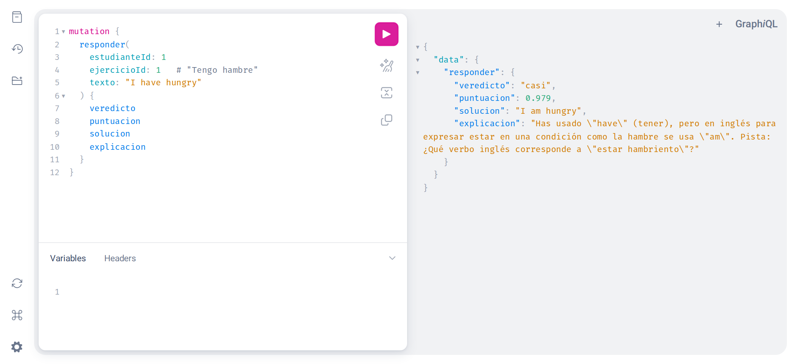

# Mnemo

[](https://github.com/tcpalbertvaldivia1993-lang/mnemo/actions/workflows/tests.yml)

Tutor de idiomas **multiagente, seguro y con modelo cognitivo**. Es un proyecto de portfolio para practicar agentes LLM, machine learning, varias bases de datos y seguridad de identidades.

## Estado: Fase 2 completada

### Fase 1: tutor y evaluador

El estudiante traduce una frase del español al inglés:

1. **Evaluador** (sentence-transformers): compara la respuesta con las soluciones válidas por similitud semántica y da un veredicto: `correcta`, `casi` o `incorrecta`.
2. **Agente Tutor** (LangChain + Ollama, o Claude si quieres): si la respuesta no es correcta, explica el error y da una pista.
3. Cada intento se guarda en **Postgres**.
4. Todo se expone con una API **GraphQL** (FastAPI + Strawberry).



*Respuesta real del Tutor con `qwen2.5:3b` en Ollama: el evaluador detecta que el significado es correcto (`casi`, 0.979) y el Tutor explica que falla el verbo.*

### Fase 2: memoria, analítica y privacidad

5. **Modelo de memoria ACT-R** (PyACTR): calcula la *activación* de cada ejercicio en la memoria del estudiante, `A = ln(Σ t_j^-d)`, y de ahí la probabilidad de recordarlo. La consulta `repaso` ordena los ejercicios del más olvidado al menos.
6. **Eventos en ClickHouse**: cada respuesta se guarda como evento para analítica.
7. **Seudonimización (en la línea de FERPA)**: ClickHouse nunca recibe el ID real del estudiante, sino un HMAC-SHA256 con clave secreta, ni el texto que escribió. Es una medida de protección; por sí sola no garantiza el cumplimiento legal.
8. **ACT-R frente a Random Forest**: `python -m mnemo.cognitivo.comparacion` compara los modelos con alumnos simulados.

```graphql
{
  repaso(estudianteId: 1, limite: 5) {
    ejercicio { enunciado }
    probabilidadRecuerdo
    nuevo
  }
}
```

#### Resultados de la comparación

Con 300 alumnos simulados y 20 ejercicios, evaluando con alumnos que los modelos no han visto:

| Modelo | AUC ↑ | Log-loss ↓ | Brier ↓ |
|---|---|---|---|
| Base (tasa media de acierto) | 0.500 | 0.689 | 0.248 |
| ACT-R (τ y s ajustados) | 0.871 | 0.445 | 0.145 |
| Random Forest | **0.937** | **0.317** | **0.098** |
| Random Forest + activación ACT-R | **0.937** | 0.318 | **0.098** |

ACT-R predice bien con solo 2 parámetros y sin saber qué intentos fueron aciertos. Random Forest gana porque usa aciertos y fallos, que en estos alumnos simulados influyen mucho en el olvido. Para que la comparación sea justa, los alumnos se simulan con **otro** modelo de olvido (vida media que crece con cada acierto), no con ACT-R. Con datos reales los resultados podrían ser distintos.

## Puesta en marcha

Requisitos (todo gratis): Docker Desktop con integración WSL, [uv](https://docs.astral.sh/uv/) y [Ollama](https://ollama.com).

```bash
curl -fsSL https://ollama.com/install.sh | sh   # instala Ollama (una vez)
ollama pull qwen2.5:3b                          # descarga el modelo (~2 GB, una vez)
cp .env.example .env              # y genera CLAVE_SEUDONIMOS (ver el archivo)
docker compose up -d              # arranca Postgres y ClickHouse
uv venv --python 3.12 .venv
uv pip install --python .venv/bin/python --index-strategy unsafe-best-match \
    --extra-index-url https://download.pytorch.org/whl/cpu torch -r requirements.txt
.venv/bin/python -m mnemo.db.semilla          # carga ejercicios de ejemplo
.venv/bin/uvicorn mnemo.api.app:app --reload  # abre http://localhost:8000/graphql
```

Ejemplo en el explorador GraphQL:

```graphql
mutation {
  responder(estudianteId: 1, ejercicioId: 1, texto: "I have hungry") {
    puntuacion
    veredicto
    explicacion
    solucion
  }
}
```

## Elegir el LLM del Tutor

En `.env`, cambia `PROVEEDOR_LLM`:

| Valor | Coste | Notas |
|---|---|---|
| `ollama` (por defecto) | Gratis | Corre en tu PC. Cambia el modelo con `MODELO_OLLAMA` (p. ej. `llama3.2:3b`) |
| `anthropic` | De pago | Mejor calidad. Necesita `ANTHROPIC_API_KEY` |
| `falso` | Gratis | Respuesta fija; útil para desarrollar sin ningún modelo |

## Tests

```bash
.venv/bin/python -m pytest
```

Se ejecutan solos en GitHub Actions con cada push (`.github/workflows/tests.yml`). Los tests usan SQLite en memoria y un Tutor simulado, así que no necesitan Docker ni gastan API. El test de integración con ClickHouse se salta si ClickHouse no está arrancado. `test_similitud.py` descarga el modelo de embeddings la primera vez (unos 500 MB).

## Estructura

```
mnemo/
├── config.py            # configuración (.env)
├── db/                  # modelos SQLAlchemy, sesión y datos de ejemplo
├── evaluador/           # similitud semántica con sentence-transformers
├── agentes/tutor.py     # agente Tutor (LangChain + Ollama/Claude)
├── cognitivo/           # ACT-R, planificador de repasos, simulación y comparación con Random Forest
├── analitica/           # eventos en ClickHouse
├── privacidad/          # seudonimización HMAC de estudiantes
└── api/                 # esquema GraphQL y app FastAPI
```

## Hoja de ruta

| Fase | Contenido |
|---|---|
| 1 ✅ | Postgres, Tutor (LangChain + Ollama/Claude), sentence-transformers, GraphQL |
| 2 ✅ | Modelo de memoria ACT-R (PyACTR), Random Forest de comparación, eventos en ClickHouse, hashing FERPA (HMAC) de los IDs |
| 3 | Bandits de Thompson sampling para elegir el tipo de ejercicio, con estado en Redis |
| 4 | Orquestador multiagente, servidores MCP, Generador de contenido en un managed-agent runtime, MongoDB |
| 5 | Agente Guardián (DeBERTa contra prompt injection), SPIFFE/WIMSE, OAuth 2.1, mensajes JWS firmados con Ed25519, A2A con un "colegio" externo |
| 6 | Curso de Python con CodeBERT |
